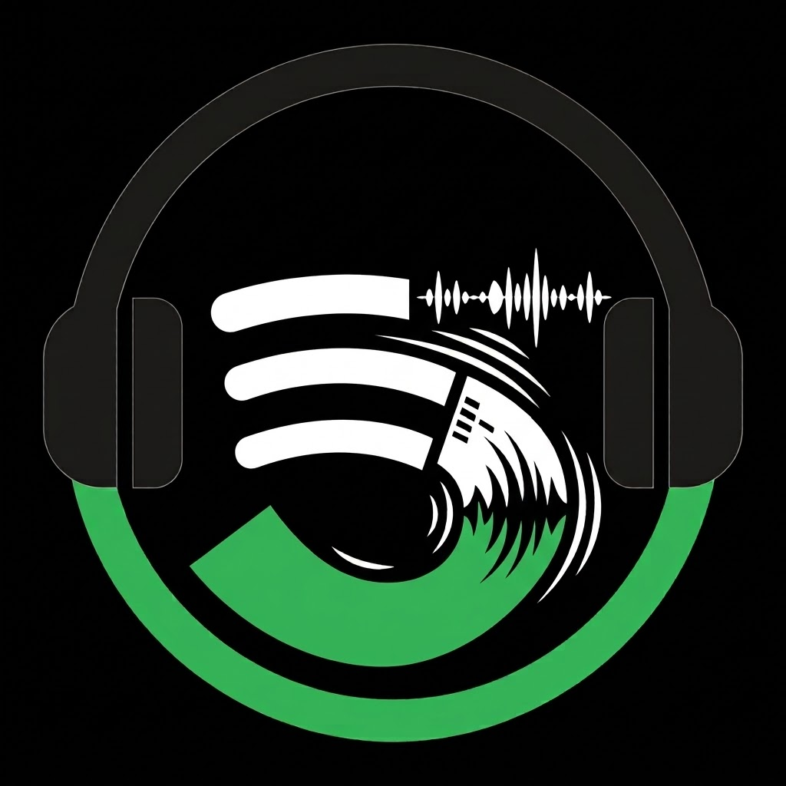

# 🎵 MusixSpot

<p align="center">
  
</p>

<p align="center">
  <strong>Modern High-Fidelity Music Streaming, Synchronized Lyrics & Discovery Platform</strong>
</p>

<p align="center">
  
  
  
  
</p>

---

## 📌 Overview

**MusixSpot** is a cross-platform music streaming and audio discovery client built using **Flutter** and **Dart**. Designed with an immersive dark aesthetic and fluid micro-animations, MusixSpot delivers an exceptional listening experience featuring real-time synchronized karaoke lyrics, background audio playback with lock-screen media controls, dynamic artist discographies, vertical short video canvas, and multi-source audio resolution.

---

## ✨ Key Features

### 🎧 High-Fidelity Audio Engine
- **Background Playback & Media Center**: Fully integrated with `just_audio` and `audio_service` to provide seamless background streaming, lock-screen notifications, and Bluetooth head unit metadata synchronization.
- **Multi-Source Stream Resolution**: Smart fallback streaming pipeline integrating Deezer APIs, YouTube Explode audio streams, and direct CDN audio endpoints.
- **Lossless & Hi-Res Support**: Native streaming support for standard MP3/AAC as well as FLAC lossless bitrates with adaptive buffering.

### 🎤 Synchronized Lyrics Engine
- **Real-Time Karaoke Scrolling**: Auto-scrolling, time-synced LRC lyric sheets with smooth highlight transitions.
- **Intelligent Tag Filtering**: Automatically parses and filters metadata tags, instrumentals, solos, and intro markers for clean readability.
- **Interactive Lyric Seeking**: Tap any line in the lyric sheet to immediately seek playback to that exact timestamp.

### 📱 Immersive Visual Experience
- **Story Canvas & Artist Shorts**: Integrated video canvas loops (`video_player`) and vertical artist video shorts synced with track playback.
- **Adaptive Dynamic Palette**: Real-time background gradient synthesis derived from active album artwork using `palette_generator`.
- **Customizable Themes**: Multiple curated dark palettes including *MusixSpot Dark*, *OLED True Black*, and vibrant accent options.

### 📚 Comprehensive Discography & Library
- **Complete Studio Discographies**: Deep artist profiles containing verified studio albums, singles, EPs, top tracks, and biographies.
- **Smart Search & Filters**: Multi-source querying across global charts, trending genres, and localized Asian & Western catalogs.
- **Playlist Management & Import/Export**: Create, customize, and back up playlists via plain-text tracklist parser and structured JSON snapshots.

---

## 🏗️ Architecture & Project Structure

The project follows a clean, reactive architecture powered by `Provider` for state management:

```
lib/
├── models/                     # Data models & entity schemas
│   ├── artist.dart             # Artist profiles, albums, and discography
│   ├── category.dart           # Browse categories and mood hubs
│   ├── playlist.dart           # Custom & editorial playlists
│   ├── song.dart               # Core track entity & streaming metadata
│   └── song_credits.dart       # Producers, songwriters, and audio engineers
├── providers/                  # Application state management
│   └── music_player_provider.dart  # Playback queue, loop/shuffle, and state
├── screens/                    # View layer & primary screens
│   ├── home_screen.dart        # Dynamic feeds, radar, and recommendations
│   ├── search_screen.dart      # Real-time search & genre browsing
│   ├── library_screen.dart     # User playlists, liked songs, and downloads
│   ├── now_playing_screen.dart # Fullscreen player with dynamic gradients
│   ├── artist_detail_screen.dart   # Artist profile, top tracks, and albums
│   ├── artist_shorts_screen.dart   # Vertical artist video reels
│   └── story_canvas_screen.dart    # Synchronized visual story canvas
├── services/                   # Business logic, APIs & system bridges
│   ├── audio_player_service.dart   # Core audio playback pipeline
│   ├── background_audio_handler.dart # System notifications & media controls
│   ├── deezer_api_service.dart     # Catalog metadata & 30s previews
│   ├── dynamic_catalog_service.dart# Featured artists & trending charts
│   ├── lyrics_service.dart         # Synced LRC fetching & line parsers
│   ├── playlist_backup_service.dart# Playlist import/export engine
│   └── song_stream_resolver.dart   # Multi-source stream extraction
├── theme/                      # Visual design tokens & theme data
│   └── spotify_theme.dart      # Color schemes, typography, and elevations
└── widgets/                    # Reusable UI components
    ├── album_card.dart         # Album & playlist card views
    ├── lyrics_sheet.dart       # Interactive modal lyrics sheet
    ├── mini_player.dart        # Persistent floating mini player
    └── song_tile.dart          # Track rows with context actions
```

---

## 🚀 Getting Started

### Prerequisites
- **Flutter SDK**: `>= 3.13.5`
- **Dart SDK**: `>= 3.0.0`
- **Android Studio** / **VS Code** with Flutter extensions
- Android device or emulator running **API 21+** (Android 5.0+) or iOS 12+

### Installation & Run

1. **Clone the repository**:
   ```bash
   git clone https://github.com/Robertkurniawan00/musixspot.git
   cd musixspot
   ```

2. **Install dependencies**:
   ```bash
   flutter pub get
   ```

3. **Run tests**:
   ```bash
   flutter test
   ```

4. **Launch the application**:
   ```bash
   flutter run
   ```

### Building Release Packages

- **Android APK**:
  ```bash
  flutter build apk --release
  ```
- **Android App Bundle (AAB)**:
  ```bash
  flutter build appbundle --release
  ```
- **Windows Desktop**:
  ```bash
  flutter build windows --release
  ```

---

## 📦 Key Dependencies

| Package | Purpose |
| :--- | :--- |
| `just_audio` | Feature-rich audio player for Flutter |
| `audio_service` | Background audio playback & lock-screen media controls |
| `just_audio_background` | Native Android/iOS notification service binding |
| `provider` | Reactive state management |
| `cached_network_image` | High-performance image caching |
| `palette_generator` | Dynamic color extraction from artwork |
| `youtube_explode_dart` | YouTube stream extraction & metadata resolver |
| `video_player` | Background canvas loops & artist short reels |
| `shared_preferences` | Persistent local user settings & preferences |

---

## 📄 License

This project is open-source software licensed under the [MIT License](LICENSE).
